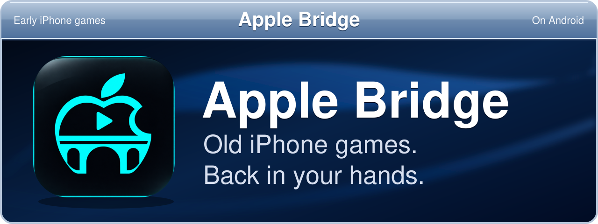
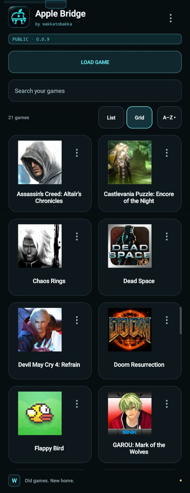

  
  

<a href="./GAME_GUIDE.md">Game guide &amp; original IPAs</a> · <a href="#request-a-game">Request a game</a>

<strong>Android 11+ / ARM64 · Bring your original game files</strong>

**Apple Bridge brings 21 early iPhone games to Android in v0.0.8.** GTA Vice City, Mass Effect Infiltrator, Infinity Blade II, Mass Effect Galaxy, Dead Space, and more share one library, with each game's original gameplay, touchscreen controls, and tilt inputs where the game uses them.

Install the player, import a matching original `.ipa`, and tap its game tile to play. The compatibility bridges are included. Original game files are supplied by you.

[Get started](#download-and-play) · [The games](#the-games) · [See it running](#see-it-running) · [Help](#testing-and-rough-edges) · [About](#why-im-making-this)

## Game library

  

## 

**You'll need:** an Android 11+ device with ARM64 support, the Apple Bridge APK, and a matching original game IPA.

1. **Download the public APK** from this repository's [**Releases** section](https://github.com/Wakkatobakka/Apple-Bridge/releases) and install it. Android may ask you to allow installation from your browser or file manager.
2. **Choose a game in the [guide](GAME_GUIDE.md).** Download its listed original IPA and keep the file intact. Match the documented edition; N.O.V.A. HD uses the listed iPad edition.
3. **Open Apple Bridge and tap Load Game.** Select the IPA and let the import finish.
4. **Tap the game's tile to play.** Import the original once, then return to it from your collection.

No separate bridge downloads or manual patching are needed. If your original came in split archive parts, extract those parts into one complete IPA before importing; keep the resulting `.ipa` intact.

**Updating?** Install the new public APK over your existing public Apple Bridge installation to keep its library and saves. Keep the existing app data.

## 

  
  

Recorded in Apple Bridge. Tap a preview to open its gameplay clip.

More gameplay — Spider-Man, Zenonia, Silent Hill, Metal Gear, and more

| Spider-Man: Total Mayhem | Zenonia |
| :---: | :---: |
| https://github.com/user-attachments/assets/9090fe6d-ad4c-4385-b693-a400a9dbb473 | https://github.com/user-attachments/assets/e4166d30-62cd-4960-aecc-e5752d6f936e |

| Devil May Cry 4: Refrain | Chaos Rings |
| :---: | :---: |
| https://github.com/user-attachments/assets/285ee3f9-f6b7-4947-931e-98cba3ddfafb | https://github.com/user-attachments/assets/a8e735a8-61d7-4df0-af07-a3f99a1dfa7e |

| Silent Hill: The Escape | Metal Gear Solid Touch |
| :---: | :---: |
| https://github.com/user-attachments/assets/745ced6f-6950-4e1d-971d-02b7be1f1e3a | https://github.com/user-attachments/assets/12b64fb4-d914-40c1-b70b-0a1d52c04693 |

| Doom Resurrection | Zombie Infection |
| :---: | :---: |
| https://github.com/user-attachments/assets/e724c0b3-b3f7-439d-b232-4782e8a03a77 | https://github.com/user-attachments/assets/65a757fe-de25-46f8-ae0d-cce56e34ad3e |

## 

An RPG you could carry in your pocket. A Doom shooter aimed by tilting the phone. A Castlevania built around falling-block battles. These games have their own ideas about what playing on a phone can feel like.

Apple Bridge brings those experiences together while keeping their individual character: the original interfaces, game settings, controls, and save systems, with an Android library around them.

- **One collection.** Search your games, switch between list and grid, and choose how to sort them.
- **Original touch and tilt.** Play through each game's own controls and tutorials.
- **Room to play.** Game views keep their original proportions, with landscape layouts using available space for the game and its utilities.
- **Useful reports.** Save a report when something goes wrong, so there is something concrete to investigate.

## 

The v0.0.8 public collection contains **21 games**: **11 additions** alongside updated bridges for the original ten. The guide has the supported original editions, filenames, download links, and playing notes.

**[Open the game guide →](GAME_GUIDE.md)**

See all 21 games and their bridge versions

| Game | What to expect | Bridge |
| --- | --- | --- |
| [Assassin’s Creed: Altaïr’s Chronicles](GAME_GUIDE.md#assassins-creed-altairs-chronicles) | Altaïr’s touchscreen action adventure | 0.0.1 |
| [Castlevania Puzzle: Encore of the Night](GAME_GUIDE.md#castlevania-puzzle-encore-of-the-night) | Falling-block battles and castle exploration | 0.0.2 |
| [Chaos Rings](GAME_GUIDE.md#chaos-rings) | Exploration and turn-based combat | 0.0.3 |
| [Dead Space](GAME_GUIDE.md#dead-space) | Third-person survival horror made for a phone | 0.0.2 |
| [Devil May Cry 4: Refrain](GAME_GUIDE.md#devil-may-cry-4-refrain) | Swords, guns, jumping, and touchscreen demon hunting | 0.0.4 |
| [Doom Resurrection](GAME_GUIDE.md#doom-resurrection) | Tilt aiming and touchscreen actions | 0.0.3 |
| [Flappy Bird](GAME_GUIDE.md#flappy-bird) | Tap-to-flap obstacle runs | 0.0.5 |
| [GAROU: Mark of the Wolves](GAME_GUIDE.md#garou-mark-of-the-wolves) | SNK fighting on a touchscreen | 0.0.1 |
| [GTA Vice City](GAME_GUIDE.md#gta-vice-city) | Vice City on Android through the original iOS game | 0.0.4 |
| [Infinity Blade II](GAME_GUIDE.md#infinity-blade-ii) | Touchscreen sword duels | 0.0.1 |
| [Mass Effect Galaxy](GAME_GUIDE.md#mass-effect-galaxy) | Jacob Taylor’s adventure with tilt movement | 0.0.16 |
| [Mass Effect Infiltrator](GAME_GUIDE.md#mass-effect-infiltrator) | A touchscreen Mass Effect shooter | 0.0.6 |
| [Metal Gear Solid Touch](GAME_GUIDE.md#metal-gear-solid-touch) | Touch aiming, cover, and a two-finger scope | 0.0.4 |
| [Monster Hunter: Dynamic Hunting](GAME_GUIDE.md#monster-hunter-dynamic-hunting) | Monster hunts built around touch controls | 0.0.3 |
| [N.O.V.A. HD](GAME_GUIDE.md#nova-hd) | The original iPad HD edition of Gameloft’s sci-fi shooter | 0.0.1 |
| [Prey Invasion](GAME_GUIDE.md#prey-invasion) | Alien encounters with touch controls | 0.0.3 |
| [Samurai II: Vengeance](GAME_GUIDE.md#samurai-ii-vengeance) | Touchscreen samurai combat | 0.0.1 |
| [Silent Hill: The Escape](GAME_GUIDE.md#silent-hill-the-escape) | Maze exploration, shooting, and tilt alignment | 0.0.7 |
| [Spider-Man: Total Mayhem](GAME_GUIDE.md#spider-man-total-mayhem) | Spider-Man’s touchscreen action adventure | 0.0.5 |
| [Zenonia](GAME_GUIDE.md#zenonia) | The original Zenonia adventure | 0.0.2 |
| [Zombie Infection](GAME_GUIDE.md#zombie-infection) | Gameloft’s third-person zombie action | 0.0.2 |

## Request a game

Want to play an old iPhone or iPad game in Apple Bridge? Tell me which one. I use these requests to decide what to try next. As long as it's feesible 😅🤣

[Browse requests by 👍](https://github.com/Wakkatobakka/Apple-Bridge/issues?q=is%3Aissue+%22Game+request%22+in%3Atitle+sort%3Areactions-%2B1-desc) · [Submit a game request](https://github.com/Wakkatobakka/Apple-Bridge/issues/new?template=game-request.yml)

If someone already requested your game, give their opening post a 👍 so the votes stay together.

## 

Every included game is personally playtested through its tutorial and into the first level, often further. Full start-to-finish completion has not been verified for every title, so later bugs or progression issues may still exist.

The [guide](GAME_GUIDE.md#help-and-troubleshooting) covers practical details such as tilt calibration, Metal Gear Solid Touch's orientation, original-file matching, and report saving. Use the release notes for changes in a particular build.

For a bug report, include the game and edition, AB version, Android device, what happened, and a saved report or short recording where possible. **SAVE REPORT** in the game writes a text report to Downloads; AB also has **Save report** in its overflow menu for library and import issues.

## 

I'm [Wakkatobakka](https://github.com/Wakkatobakka). This is a one-person hobby, working with AI to investigate, build, test, and iterate around my job and family.

I like finding the odd corners of gaming history and getting them playable again. These iPhone games turned out to be a lot of fun. Apple Bridge gives them a shared home, and gives more people a way to try them.

Specifically though, this one came from me (and I'm repeating basically what I put on my release page) getting a stick up my ass about Bioware getting the axe. I love their games. so this is my attempt at something I guess.

## 

Players supply the original game files. The [game guide](GAME_GUIDE.md) records the supported editions, recognizable filenames, direct IPA links, and source pages, with optional fingerprints for file verification.

The compatibility bridges build on [touchHLE](https://touchhle.org/) and its contributors' work. Apple Bridge uses modified touchHLE-based builds; runtime and dependency credits remain with their respective contributors. Component license texts and notices are retained with the bundled bridges.

Original games, artwork, music, and trademarks belong to their respective owners. Credit for preserving and sharing the archived originals belongs to the archive uploaders and preservation contributors. Their source pages are linked from the guide.

Page graphics use the existing Apple Bridge app icon and original game artwork. [Artwork sources](./assets/apple-bridge/ARTWORK_NOTES.txt).
