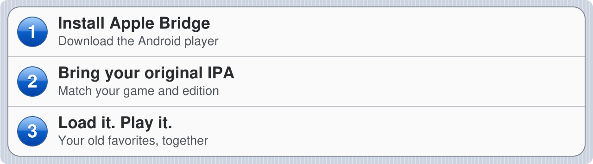
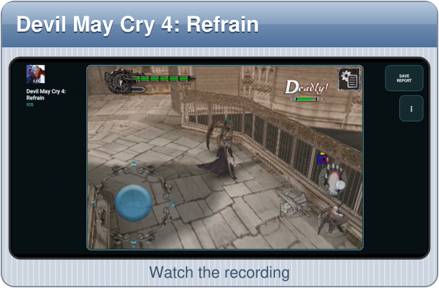
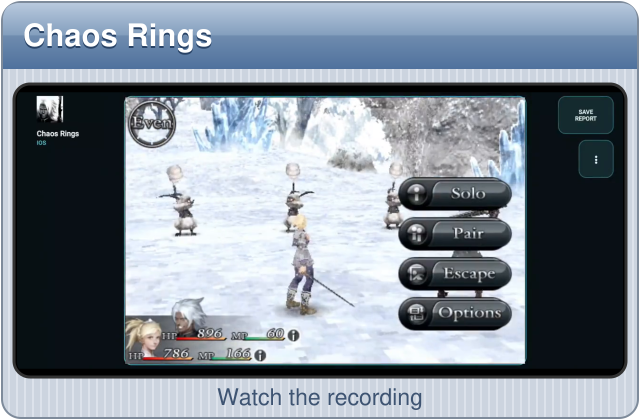

  
  

<a href="./GAME_GUIDE.md">Game guide &amp; original IPAs</a> · <a href="#see-it-running">See it running</a> · <a href="#the-games">The games</a> · <a href="#request-a-game">Request a game</a> · <a href="#testing-and-rough-edges">Help</a> · <a href="#why-im-making-this">About</a>

<strong>Android 11+ / ARM64 · Bring your original game files</strong>

**Apple Bridge brings 21 early iPhone games to Android in v0.0.9.** GTA Vice City, Mass Effect Infiltrator, Infinity Blade II, Dead Space, and more share one library, each keeping its own interface, touchscreen and tilt controls, and save system. **Now with Bluetooth controller support**, with mappable weapons and saved profiles.

These games have their own ideas about what playing on a phone can feel like: an RPG you could carry in your pocket, a Doom shooter aimed by tilting the phone, a Castlevania built around falling-block battles.

## Get started

  

- **Install** the public APK from the [Releases](https://github.com/Wakkatobakka/Apple-Bridge/releases) page. Android may ask you to allow installs from your browser or file manager. The compatibility bridges are included, so there is nothing else to download or patch.
- **Match the edition.** Pick a game in the [guide](GAME_GUIDE.md), download its listed original IPA, and keep the file intact. N.O.V.A. HD uses the listed iPad edition.
- **Import once.** Open Apple Bridge, tap **Load Game**, and select the IPA. After that the game lives in your library.
- **Split archive parts?** Extract them into one complete `.ipa` before importing.
- **Updating?** Install the new APK over your existing one to keep your library and saves.

## See it running

  
  

Recorded in Apple Bridge. Tap a preview to open its gameplay clip.

More gameplay: Spider-Man, Zenonia, Silent Hill, Metal Gear, and more

| Spider-Man: Total Mayhem | Zenonia |
| :---: | :---: |
| https://github.com/user-attachments/assets/9090fe6d-ad4c-4385-b693-a400a9dbb473 | https://github.com/user-attachments/assets/e4166d30-62cd-4960-aecc-e5752d6f936e |

| Silent Hill: The Escape | Metal Gear Solid Touch |
| :---: | :---: |
| https://github.com/user-attachments/assets/745ced6f-6950-4e1d-971d-02b7be1f1e3a | https://github.com/user-attachments/assets/12b64fb4-d914-40c1-b70b-0a1d52c04693 |

| Doom Resurrection | Zombie Infection |
| :---: | :---: |
| https://github.com/user-attachments/assets/e724c0b3-b3f7-439d-b232-4782e8a03a77 | https://github.com/user-attachments/assets/65a757fe-de25-46f8-ae0d-cce56e34ad3e |

## The games

  

Eleven are new in v0.0.9, and the original ten got updated bridges. Search your library, switch between list and grid, and sort however you like. The [game guide](GAME_GUIDE.md) has the supported original editions, filenames, download links, and playing notes.

Full game list

| Game | What to expect |
| --- | --- |
| [Assassin’s Creed: Altaïr’s Chronicles](GAME_GUIDE.md#assassins-creed-altairs-chronicles) | Altaïr’s touchscreen action adventure |
| [Castlevania Puzzle: Encore of the Night](GAME_GUIDE.md#castlevania-puzzle-encore-of-the-night) | Falling-block battles and castle exploration |
| [Chaos Rings](GAME_GUIDE.md#chaos-rings) | Exploration and turn-based combat |
| [Dead Space](GAME_GUIDE.md#dead-space) | Third-person survival horror made for a phone |
| [Devil May Cry 4: Refrain](GAME_GUIDE.md#devil-may-cry-4-refrain) | Swords, guns, jumping, and touchscreen demon hunting |
| [Doom Resurrection](GAME_GUIDE.md#doom-resurrection) | Tilt aiming and touchscreen actions |
| [Flappy Bird](GAME_GUIDE.md#flappy-bird) | Tap-to-flap obstacle runs |
| [GAROU: Mark of the Wolves](GAME_GUIDE.md#garou-mark-of-the-wolves) | SNK fighting on a touchscreen |
| [GTA Vice City](GAME_GUIDE.md#gta-vice-city) | Vice City on Android through the original iOS game |
| [Infinity Blade II](GAME_GUIDE.md#infinity-blade-ii) | Touchscreen sword duels |
| [Mass Effect Galaxy](GAME_GUIDE.md#mass-effect-galaxy) | Jacob Taylor’s adventure with tilt movement |
| [Mass Effect Infiltrator](GAME_GUIDE.md#mass-effect-infiltrator) | A touchscreen Mass Effect shooter |
| [Metal Gear Solid Touch](GAME_GUIDE.md#metal-gear-solid-touch) | Touch aiming, cover, and a two-finger scope |
| [Monster Hunter: Dynamic Hunting](GAME_GUIDE.md#monster-hunter-dynamic-hunting) | Monster hunts built around touch controls |
| [N.O.V.A. HD](GAME_GUIDE.md#nova-hd) | The original iPad HD edition of Gameloft’s sci-fi shooter |
| [Prey Invasion](GAME_GUIDE.md#prey-invasion) | Alien encounters with touch controls |
| [Samurai II: Vengeance](GAME_GUIDE.md#samurai-ii-vengeance) | Touchscreen samurai combat |
| [Silent Hill: The Escape](GAME_GUIDE.md#silent-hill-the-escape) | Maze exploration, shooting, and tilt alignment |
| [Spider-Man: Total Mayhem](GAME_GUIDE.md#spider-man-total-mayhem) | Spider-Man’s touchscreen action adventure |
| [Zenonia](GAME_GUIDE.md#zenonia) | The original Zenonia adventure |
| [Zombie Infection](GAME_GUIDE.md#zombie-infection) | Gameloft’s third-person zombie action |

## Request a game

Want to play an old iPhone or iPad game in Apple Bridge? Tell me which one. I use these requests to decide what to try next, as long as it's feasible 😅🤣

[Browse requests by 👍](https://github.com/Wakkatobakka/Apple-Bridge/issues?q=is%3Aissue+%22Game+request%22+in%3Atitle+sort%3Areactions-%2B1-desc) · [Submit a game request](https://github.com/Wakkatobakka/Apple-Bridge/issues/new?template=game-request.yml)

If someone already requested your game, give their opening post a 👍 so the votes stay together.

## Testing and rough edges

Every included game is personally playtested through its tutorial and into the first level, often further. Full start-to-finish completion has not been verified for every title, so later bugs or progression issues may still exist.

The [guide](GAME_GUIDE.md#help-and-troubleshooting) covers practical details such as tilt calibration, Metal Gear Solid Touch's orientation, original-file matching, and report saving. Use the release notes for changes in a particular build.

For a bug report, include the game and edition, Apple Bridge version, Android device, what happened, and a saved report or short recording where possible. **SAVE REPORT** in the game writes a text report to Downloads. Apple Bridge also has **Save report** in its overflow menu for library and import issues.

## Why I'm making this

I'm [Wakkatobakka](https://github.com/Wakkatobakka). This is a one-person hobby, working with AI to investigate, build, test, and iterate around my job and family.

I like finding the odd corners of gaming history and getting them playable again. These iPhone games turned out to be a lot of fun. Apple Bridge gives them a shared home, and gives more people a way to try them.

Specifically, though, this one came from me getting a stick up my ass about Bioware getting the axe. I love their games, so this is my attempt at something, I guess.

## Originals, preservation, and credits

Players supply the original game files. The [game guide](GAME_GUIDE.md) records the supported editions, recognizable filenames, direct IPA links, and source pages, with optional fingerprints for file verification.

The compatibility bridges build on [touchHLE](https://touchhle.org/) and its contributors' work. Apple Bridge uses modified touchHLE-based builds; runtime and dependency credits remain with their respective contributors. Component license texts and notices are retained with the bundled bridges.

Original games, artwork, music, and trademarks belong to their respective owners. Credit for preserving and sharing the archived originals belongs to the archive uploaders and preservation contributors. Their source pages are linked from the guide.

Page graphics use the existing Apple Bridge app icon and original game artwork. [Artwork sources](./assets/apple-bridge/ARTWORK_NOTES.txt).
